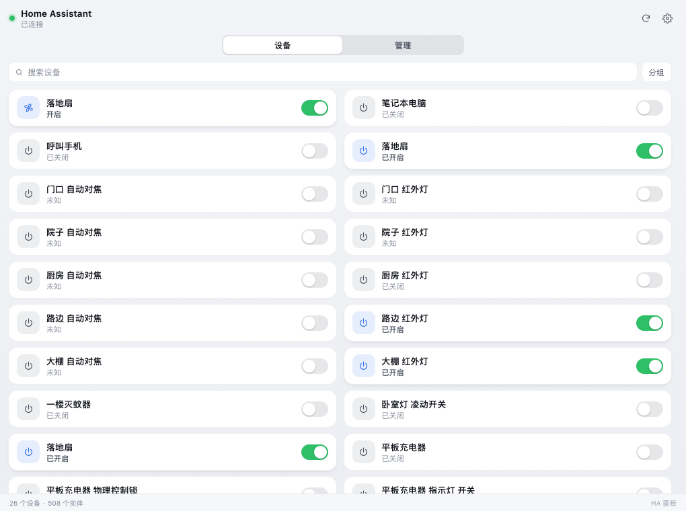
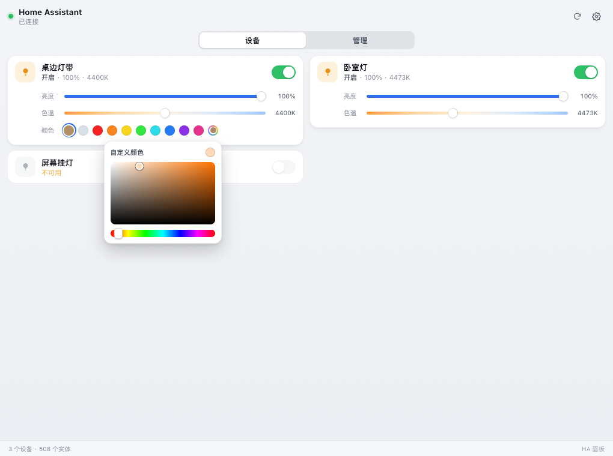
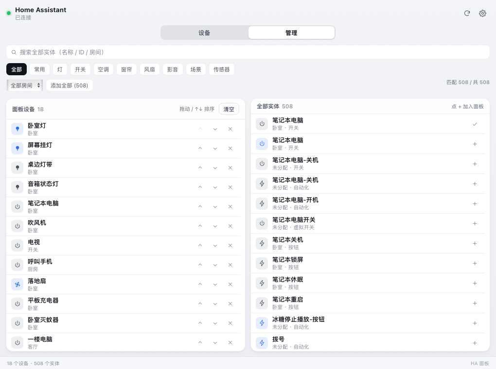

# HA 面板 · macOS 菜单栏 Home Assistant 控制台

点一下菜单栏的小房子，弹出一个两列布局的控制面板，直接操控 Home Assistant 里的灯、空调、窗帘、风扇等设备。不上云、不走中转，原生 App 直连你的 HA 实例。



## 为什么做这个

HA 官方的 Lovelace 是网页，放在菜单栏里要么开浏览器、要么用一堆窗口管理工具。这个 App 只做一件事：**常驻菜单栏，点开立刻能用**，并且针对「实体特别多」的场景做了管理页——几百个实体里挑出常用的几十个，排序、分组、搜索都能快速完成。

## 功能

| 类型 | 支持的操作 |
|---|---|
| 灯 light | 开关、亮度、色温（按灯具实际的 min/max K）、10 个颜色预设 + **内置取色盘**（色相条 + 明度/饱和度方块，任意 RGB，拖动实时生效） |
| 空调 climate | 模式（制冷/制热/除湿/送风/自动/关闭）、目标温度 ±0.5°、温度滑块 |
| 窗帘 cover | 开启 / 停止 / 关闭 / 位置百分比 |
| 风扇 fan | 开关、风速百分比（设备支持调速时才出现） |
| 影音 media_player | 播放暂停、上一首/下一首、音量 |
| 开关 switch / input_boolean | 开关（整行可点，不用精准点小圆钮） |
| 场景 / 脚本 / 自动化 / 按钮 | 一键执行 |
| 门锁 lock | 上锁 / 解锁 |
| 扫地机 vacuum | 开始 / 暂停 / 回充 |
| 传感器等其他实体 | 只读展示（可以加进面板看数值） |

### 取色盘



取色盘是**画在面板内部**的，不走 macOS 系统色板。早期版本用 `<input type="color">`，系统色板一抢 key window，NSPopover 就会立刻收起——这是这套壳子的一个典型坑。

### 管理大量设备



管理页是左右双栏，两栏各自滚动、互不影响：

1. **搜索**：按名称、实体 ID、房间搜；输入时只重建右侧结果列表，光标不跳、中文输入法不被打断
2. **筛选**：常用 / 灯 / 开关 / 空调 / 窗帘 / 风扇 / 影音 / 场景 / 传感器，加房间下拉框
3. **批量**：「添加全部 (n)」把当前筛选结果一次性加进面板
4. **排序**：左栏是独立滚动的列表，可拖动排序、也能用 ↑↓ 微调；拖到上下边缘自动滚动
5. **分组**：设备页一键按 HA 房间归类

添加 / 移除 / 排序都立刻写入本机偏好，重启不变。

### 推送过滤

HA 把 `entity_category = diagnostic` 的实体（设备自带「信息」按钮、CPU/内存占用、固件更新等）也算 state 变化。这些对控制毫无用处，却往往占了推送量的绝大部分。

原生层在解析实体时记录诊断标记，`state_changed` 到达时直接丢弃，不进 JS、不触发重绘：实测下发量从 ~1.2 次/秒降到 ~0.25 次/秒（过滤率约 80%）。手动加进面板的实体永不参与过滤，设置页也可以整体关掉该过滤。

## 安装

需要 macOS 14+ 和 Xcode 命令行工具（`xcode-select --install`）。

```bash
git clone https://github.com/2539421072/HABar.git
cd HABar
./build.sh
cp -R "HA 面板.app" /Applications/
open "/Applications/HA 面板.app"
```

首次启动后点菜单栏图标 → 右上角齿轮：

- **地址**：你的 HA 地址，例如 `http://homeassistant.local:8123` 或 `http://192.168.1.10:8123`
- **长期访问令牌**：HA 网页 → 左下角个人资料 → 安全 → 长期访问令牌 → 创建

保存后即连接。令牌只写进本机 UserDefaults（`cn.local.habar`），不落配置文件、不上传任何地方。

## 使用

- 点图标 → 打开面板；再点一次 / 按 `Esc` / 点面板外 → 关闭
- 右键图标 → 刷新状态 / 重新连接 / 退出
- `/` 或 `⌘F` 聚焦搜索
- 设置页可开启开机自启（写 `~/Library/LaunchAgents/cn.local.habar.plist`）

## 技术实现

原生 ObjC + WKWebView，不是 Electron：内存几十 MB，启动即用，没有 runtime 依赖。

- `NSStatusItem` + `NSPopover`（`transient` 行为）+ `WKWebView`，1020×760 双列卡片布局
- `HAClient`：REST（`/api/states`、`/api/services/*`、模板 API 拉房间注册表）+ WebSocket（`auth` → `subscribe_events` / `state_changed`，25s ping，断线 5s 重连）
- `WKScriptMessageHandler` 双向桥：JS 发指令走 `webkit.messageHandlers`，原生推状态时做 120ms 批处理去重
- 前端状态门控：输入框聚焦（`isTyping()`）或取色盘打开时不重绘，改成 `pendingRender` 延后。否则每来一次状态推送就把整页 `innerHTML` 换掉，输入框节点被销毁——这正是「搜索框打几个字就断」的根因
- 界面完全由 `web/` 三件套渲染，改样式不用碰 ObjC

### 目录

```
main.m          菜单栏图标、NSPopover、WKWebView、JS 桥、开机自启、调试参数
HAClient.h/.m   REST + WebSocket 客户端（鉴权、房间注册表、服务调用、推送过滤）
web/app.js      全部界面逻辑（设备卡片、控件、管理页）
web/styles.css  样式（浅色/深色自动跟随系统）
web/index.html  SVG symbol 图标集
icon.svg        App 图标
build.sh        编译 + 渲染图标 + 打包 + ad-hoc 签名
```

### 调试参数

```bash
./habar --snapshot out.png --size 1020x760 --delay 4      # 无头截图
./habar --show                                            # 启动即弹面板，窗口号写入 /tmp/habar-debug.log
./habar --stats                                           # 每 10 秒打印 收到 / 过滤 / 下发 三个计数
```

注意：直接跑 `./habar` 时 `NSBundle` 找不到 `web/` 里的资源（`mainBundle` 指向可执行文件所在目录），做无头截图请把 `web/*` 拷到同目录，或直接跑 `.app` 里的可执行文件。

## 许可

MIT
